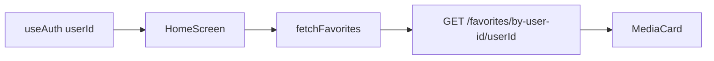

# Load favorites from the API

The home screen currently imports a static array from [`src/data/media.ts`](src/data/media.ts) and maps it into [`MediaCard`](src/components/MediaCard.tsx). Favorites come from `GET https://flucom-api-bun.developedbyluan.workers.dev/favorites/by-user-id/{userId}`, which returns a JSON array with the same fields as `MediaItem`. The path uses the signed-in Clerk user id from `useAuth()`, so each account sees its own list. The sample id `user_32kRIJ5bCMhzrG1bI9dnMWPDzR7` is only an example of that path. No auth header is sent.

The home tab is already behind sign-in: [`src/app/index.tsx`](src/app/index.tsx) redirects to `/(tabs)` only when `isSignedIn` is true.

## Changes

- Keep the `MediaItem` type in [`src/data/media.ts`](src/data/media.ts) and delete the static `mediaItems` array.
- Add `fetchFavorites(userId: string)` in that file. It requests `/favorites/by-user-id/${encodeURIComponent(userId)}`, checks `response.ok`, and returns `response.json()` as `MediaItem[]`.
- Update [`src/app/(tabs)/index.tsx`](<src/app/(tabs)/index.tsx>) to read `userId` and `isLoaded` from `useAuth()` in `@clerk/expo`, then load when `userId` is available:
  - While Clerk or the request is loading, show an `ActivityIndicator`.
  - If there is no `userId`, show a short signed-out message.
  - On failure, show the error message.
  - On success, map the items into `MediaCard` the same way as today (`id`, `fileName`, `fileAuthor`, `fileThumbnailUrl`).
  - If the array is empty, show a short empty-state message.

No new dependencies. After the edit, run `npx tsc --noEmit`. This is a native screen, so it will not be verified in the browser.
