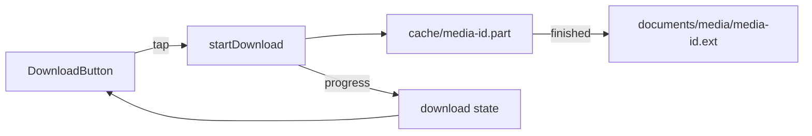

# Downloading media to the phone

The download button on each favorite card now downloads the media from `MediaItem.fileUrl` and saves it on the phone. This is the first step toward playing media offline. Nothing plays the downloaded files yet.

## What the button does

| State | Button shows | Tapping it |
| --- | --- | --- |
| Not downloaded | Circle with a down arrow | Starts the download |
| Downloading | A spinner while the transcript is saved, then the media progress, like `42%`. It stays a spinner if the server doesn't send the file size | Cancels the download |
| Downloaded | Filled blue circle with a white checkmark | Asks "Remove download?". **Remove** deletes the media, transcript and thumbnail |

Until a card's media is downloaded, its thumbnail, title and author are dimmed to 40% opacity. The download button stays at full opacity. A card becomes fully visible once its download finishes, and dims again if the download is removed. This way users can tell which media is on the phone at a glance. Cards with no `mediaId` or `fileUrl` can't be downloaded, so they aren't dimmed.

If a download fails, the app shows a toast and the button goes back to the down arrow. With no internet, the toast says "You're offline. Connect to the internet to download this lesson."; otherwise it says "Couldn't download this lesson. Please try again." See [feedback-ui.md](feedback-ui.md).

Screen readers announce the button as "Download <title>", "Cancel download of <title>" or "Remove download of <title>", depending on the state.

## Where files are stored

```
<app documents>/media/media-<mediaId><ext>     the media file
<app documents>/media/media-<mediaId>.json     its transcript
<app documents>/media/media-<mediaId>-thumb    its thumbnail
```

- **Transcripts are required.** The transcript comes from `GET /json/{fileJsonId}` (see [Transcript format](#transcript-format)). A download saves it **first**, then the media file. The checkmark only appears once both are saved.
  - If the transcript fails, the download stops before any media is downloaded. The alert says "Couldn't download the transcript: …".
  - If the media then fails, or the user cancels, the saved transcript is deleted. Nothing is kept.
  - The transcript is checked after it's saved: it must be an object whose `json` is an array. This stops an error page from being saved as a transcript.
  - Whether an item is downloaded is still decided by the media file. The media file is moved into place last, so a finished download always has its transcript.
  - Items downloaded before transcripts were saved keep their checkmark. Their transcript is saved in the background the next time the card is shown while online.

- **Thumbnails** are saved right after the media file, from `fileThumbnailUrl`, so a downloaded item shows its real thumbnail offline. The thumbnail file has no extension. Android's and iOS's image decoders read the format from the file's contents.
  - Saving the thumbnail is best effort. If it fails, the media still counts as downloaded, and the app tries again the next time the card is shown while online.
  - Items downloaded before thumbnails were saved get theirs the same way.

- **`<ext>`** is the extension at the end of `fileUrl`'s path, ignoring any `?query` or `#hash`. For example, `.mp3` or `.mp4`. If the URL has no extension, the file has none.
- **One copy per media.** Files are named by `mediaId`, not by user, so every account on the phone shares them. Media files are served from public URLs, so they aren't private to a user. This is unlike the saved favorites list, which is stored per user.
- **Safe partial downloads.** A download first goes to `<app cache>/media-<mediaId>.part`. It's moved into `media/` only after it finishes. A half-finished file is therefore never shown as downloaded.



## Files changed

### `src/data/mediaDownloads.ts` (new)

Keeps the download state and does the file work, using `File`, `Directory` and `Paths` from `expo-file-system`.

```ts
export type DownloadState =
  | { status: "none" }
  | { status: "downloading"; progress: number | null } // 0–100; null when the size is unknown
  | { status: "downloaded"; hasThumbnail: boolean; hasTranscript: boolean };

// What's needed to download an item.
export type DownloadSource = {
  mediaId: number;
  fileUrl: string;
  fileJsonId: number;
  thumbnailUrl?: string;
};
```

The state is kept at module level, not inside a component. This has two effects:

- **Downloads keep going.** A download continues when its card or screen unmounts, for example after switching tabs.
- **Duplicate cards stay in sync.** Two cards with the same `mediaId` show the same state, and they can't start two downloads of one file.

| Function | What it does |
| --- | --- |
| `getDownloadState(mediaId, fileUrl)` | Returns the state. The first call for a `mediaId` checks whether the file exists, and the answer is cached. The same object comes back until the state changes, which `useSyncExternalStore` requires. |
| `startDownload(source)` | Saves the transcript, then downloads the media with `File.downloadFileAsync(url, tempFile, { idempotent, signal, onProgress })` and moves it into `media/`. It does nothing if the media is already downloading or downloaded. It rejects if either step fails, after deleting what it saved, but not when cancelled. |
| `cancelDownload(mediaId)` | Cancels the download through its `AbortController`. |
| `deleteDownload(mediaId, fileUrl)` | Deletes the media, transcript and thumbnail files. |
| `subscribeDownloads(listener)` | Calls `listener` whenever any state changes. |
| `useMediaDownload(mediaId, fileUrl)` | A React hook that returns the state and re-renders when it changes. |
| `getLocalMediaUri(mediaId, fileUrl)` | Returns the downloaded file's `file://` URI, or `null` if it isn't on the phone. It checks the disk. If the file was removed outside the app, it also resets the cached state to `none`, so the card updates. |
| `getPlaybackUri(mediaId, fileUrl)` | Returns the local URI when the file is downloaded, otherwise `fileUrl`. |
| `useLocalMediaUri(mediaId, fileUrl)` | A React hook that returns the local URI or `null`, and re-renders when a download finishes or is removed. It reads the cached state, so it doesn't check the disk on every render. |
| `ensureExtras(source)` | Saves what a downloaded item is missing: its thumbnail (when `hasThumbnail` is false and there's a URL), and its transcript (when `hasTranscript` is false, which only happens for items downloaded before transcripts were saved). It does nothing if the item isn't downloaded or is already saving these. It never rejects. Failures are retried on the next call. If the download is removed meanwhile, it deletes what it saved. |
| `getLocalThumbnailUri(mediaId)` | Returns the saved thumbnail's `file://` URI, or `null`. It reads the cached state, so it's cheap to call while rendering. |
| `loadLocalTranscript(mediaId)` | Reads the saved transcript. Returns the parsed `MediaJson`, or `null` if it's missing or unreadable. |
| `getTranscript(mediaId, fileJsonId)` | Returns the saved transcript when there is one, otherwise fetches it with `fetchMediaJson`. |

When both the transcript and the media are saved, `startDownload` sets the state to `downloaded`, then calls `ensureExtras` in the background for the thumbnail. All three files go through the same steps in the helper `downloadTo()`: download to a `.part` file in the cache, then move it into `media/`.

Progress only updates the state when the whole percentage changes, so a download triggers at most about 100 re-renders.

#### Using it from a player

```ts
import { getPlaybackUri, getTranscript } from "@/data/mediaDownloads";

const uri = getPlaybackUri(item.mediaId, item.fileUrl);
// "file:///…/media/media-42.mp3" when downloaded, otherwise "https://media.speakfc.com/…"
const transcript = await getTranscript(item.mediaId, item.fileJsonId);
// the saved copy when downloaded, otherwise fetched from the API
```

Pass `uri` to `expo-audio` or `expo-video`. In a player screen that should switch to the local file as soon as a download finishes, use `useLocalMediaUri(...) ?? item.fileUrl` instead.

Never save the URI, for example in AsyncStorage or with the favorites list. Work it out each time with these functions. On iOS the app's documents folder path can change after an app update, so a saved absolute path could point to a folder that no longer exists.

These real media URLs were checked: `.mp4` and `.MP3` files on `media.speakfc.com`. Each returns `200` with `video/mp4` or `audio/mpeg` and a `content-length`. They're saved as `.mp4` and `.mp3`, extensions the iOS and Android players recognize.

### `src/components/DownloadButton.tsx` (new)

This is the 44×44 button. It reads `useMediaDownload` and does what the table above describes. The "Remove download?" question uses the in-app `confirm()` dialog, and errors use `showToast()` (see [feedback-ui.md](feedback-ui.md)).

### `src/components/DownloadIcon.tsx`

The new `downloaded` prop switches between two icons:

```ts
const ICONS = {
  download: { ios: "arrow.down.circle", material: 0xf181 },        // arrow_circle_down
  downloaded: { ios: "checkmark.circle.fill", material: 0xe86c },  // check_circle, filled
} as const;
```

Android and web still draw the Material Symbols character themselves. [download-button.md](download-button.md) explains why.

The downloaded icon is a filled blue circle (`colors.accent`, `#007AFF`, added to `src/styles/global.ts`) with a white checkmark. It ignores the `color` prop.

- **iOS:** `SymbolView` with `type="palette"` and `colors={["#FFFFFF", colors.accent]}`. The first color goes to the checkmark and the second to the circle.
- **Android and web:** the filled check_circle character from the `MaterialSymbols_400Regular_Filled` font, which ships in the same `@expo-google-fonts/material-symbols` package. In that font the checkmark is a see-through cutout. A white disc, 60% of the icon size, is drawn behind it, so the checkmark is white on any background.

### `src/components/MediaCard.tsx`

- The `onDownload` prop was removed, and `fileUrl?: string` was added.
- The card takes a `fileJsonId?: number` prop. It renders `<DownloadButton mediaId fileUrl fileJsonId thumbnailUrl name />` only when `mediaId`, `fileUrl` and `fileJsonId` are all set.
- The card reads `useMediaDownload(mediaId, fileUrl)` itself and applies `opacity: 0.4` (`NOT_DOWNLOADED_OPACITY`) to the thumbnail and the text block when the status isn't `downloaded`. The opacity is set on those two views, not on the whole card, so the button isn't dimmed. `useMediaDownload` accepts an undefined `mediaId` or `fileUrl` and returns `null` in that case.
- **Thumbnails** are drawn with `Image` from `expo-image`, replacing React Native's `Image`. `expo-image` has been a dependency since the project started, so the development build already includes it. The card tries these sources in order:
  1. The saved thumbnail (`getLocalThumbnailUri`), for downloaded items. It's shown with `cachePolicy="memory"`, because a local file doesn't need the disk cache.
  2. The remote `thumbnail` URL, with `cachePolicy="disk"`. `expo-image` keeps a copy on disk regardless of the server's cache headers, so items that aren't downloaded usually also show offline once they've been seen online.
  3. The bundled fallback image.

  If a source fails to load, the card adds it to a list of failed URIs and moves on to the next one, so it can't loop between two broken images.
- A `useEffect` calls `ensureExtras` when the item is downloaded but is missing its thumbnail (and has a thumbnail URL) or its transcript. The effect doesn't set React state itself, so it's fine with the `react-hooks/set-state-in-effect` lint rule.
- `DownloadButton` calls `startDownload({ mediaId, fileUrl, fileJsonId, thumbnailUrl })`.

### `src/app/(tabs)/index.tsx`

Passes `mediaId={item.mediaId}`, `fileUrl={item.fileUrl}` and `fileJsonId={item.fileJsonId}` to each card.

### `src/data/media.ts`

Adds the transcript types, `mediaJsonUrl(fileJsonId)`, `isMediaJson(value)` and `fetchMediaJson(fileJsonId)`. `fetchMediaJson` follows the same pattern as `fetchFavorites`. It throws `Failed to load transcript (<status>)` on an error response, and `Failed to load transcript (unexpected format)` if the shape check fails.

## Transcript format

`GET https://flucom-api-bun.developedbyluan.workers.dev/json/{fileJsonId}`, no auth. Sample `fileJsonId` 168 is 21 KB with 83 lines covering about 7 m 54 s.

```ts
type Speaker = "question" | "answer" | "" | `${string}:`;

type TranscriptLine = {
  id: number;       // 1, 2, 3, … in order
  start: number;    // seconds into the media
  end: number;      // seconds into the media
  target: string;   // English sentence
  ipa: string;      // IPA pronunciation of target
  mine: string;     // Vietnamese translation
  speaker: Speaker;
};

type MediaJson = {
  id: number;              // the fileJsonId
  json: TranscriptLine[];  // the lines are under the key "json"
  createdAt: string;       // ISO date
  updatedAt: string;       // ISO date
};
```

- **`speaker`:**
  - `"question"` and `"answer"` mark the Q&A lines.
  - A label ending in a colon, like `"Narrator:"`, names who is speaking. Strip the colon to show it: `speaker.endsWith(":") ? speaker.slice(0, -1) : null`.
  - `""` continues without a new label.
- **`target` often starts with `"\n"`** (77 of 83 lines in the sample). Trim it before showing the text.
- **Timing:** in the sample, the lines are in time order and don't overlap. A player can highlight the line where `start ≤ currentTime < end`.

## Verification

- `npx tsc --noEmit` passes.
- `npx expo lint` passes.
- **Not yet tested on a device.**

## Testing on a phone

This change is JavaScript only. `expo-file-system` is already part of the development build, so it doesn't need to be rebuilt. To start the app, follow the steps in [remote-favorites.md](remote-favorites.md#running-it-on-an-android-phone).

1. Tap the download button. The percentage counts up, then the checkmark appears.
2. Start a download, switch to Settings, and come back. The download is still going or finished.
3. Start a download and tap the button again. It cancels, and the down arrow comes back.
4. Turn on airplane mode and tap download. A "Download failed" alert appears.
5. Reload the app. Cards you downloaded still show the checkmark.
6. Tap a checkmark, then **Remove**. The down arrow comes back.
7. If two cards have the same `mediaId`, they change together.
8. **Offline thumbnails:** download an item while online. In Android Settings, open the app's storage and tap **Clear cache**, not "Clear data". Then reopen the app in airplane mode. The downloaded item still shows its real thumbnail. Items that aren't downloaded show the fallback image, because clearing the cache removed their cached copy.
9. **Older downloads:** an item downloaded before thumbnails and transcripts were saved keeps its checkmark. It gets both the first time the home tab is opened online. After that, step 8 works for it too.
10. **Transcript saved:** download an item, turn on airplane mode, and call `loadLocalTranscript(mediaId)`, for example from a temporary `console.log`. It returns the transcript object.
11. **Transcript failure:** temporarily pass `fileJsonId={999999}` in `index.tsx` and tap download. The API returns `200` with an empty body for an unknown ID, not a `404`. The format check rejects it, and a "Download failed" alert says "Couldn't download the transcript: unexpected format". The card stays not downloaded, and no media is downloaded.
12. **Cancel during the spinner** (while the transcript is being saved). Nothing is kept.

## Known limitations

- **No offline playback yet.** `getPlaybackUri` gives a player the local file, but there's no player yet. Building one needs `expo-audio` and/or `expo-video`, which contain native code, so a new development build is required.
- **Downloads outlive accounts and favorites.** Signing out doesn't delete them, and neither does removing a favorite. The only way to free the space is the **Remove** button on each card.
- **Killing the app loses the download.** Its leftover `.part` file in the cache is overwritten by the next attempt, or cleaned up by the system.
- **No background downloads.** Downloads run only while the app is running. They aren't resumed after a restart.
- **No storage view.** There's no screen showing how much space downloads use, and no "remove all".
- **Saved thumbnails and transcripts aren't refreshed.** If the server changes an item's thumbnail or transcript, the saved copy stays until the download is removed and downloaded again.
- **The transcript check is light.** It only checks that `json` is an array, not every field of every line.
- **Thumbnails of items that aren't downloaded can still disappear offline.** They come from `expo-image`'s disk cache, which the system or the user can clear.
- **Plain files only.** `fileUrl` must point to an actual file. A streaming playlist URL (such as HLS `.m3u8`) would save only the playlist, not the media.

> **Update:** downloaded items now update themselves when `updatedAtOfMedia` changes, and the list refreshes on pull-to-refresh and when the app returns. See [download-updates.md](download-updates.md).
