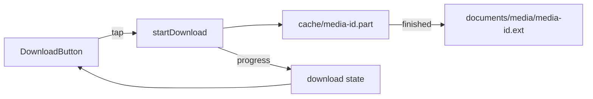

# Downloading media to the phone

The download button on each favorite card now downloads the media from `MediaItem.fileUrl` and saves it on the phone. This is the first step toward playing media offline. Nothing plays the downloaded files yet.

## What the button does

| State | Button shows | Tapping it |
| --- | --- | --- |
| Not downloaded | Circle with a down arrow | Starts the download |
| Downloading | Progress, like `42%`. A spinner if the server doesn't send the file size | Cancels the download |
| Downloaded | Circle with a checkmark | Asks "Remove download?". **Remove** deletes the file |

If a download fails (for example, with no internet), the app shows a "Download failed" alert with the error, and the button goes back to the down arrow.

Screen readers announce the button as "Download <title>", "Cancel download of <title>" or "Remove download of <title>", depending on the state.

## Where files are stored

```
<app documents>/media/media-<mediaId><ext>
```

- **`<ext>`** is the extension at the end of `fileUrl`'s path, ignoring any `?query` or `#hash`. For example, `.mp3` or `.mp4`. If the URL has no extension, the file has none.
- **One copy per media.** Files are named by `mediaId`, not by user, so every account on the phone shares them. Media files are served from public URLs, so they aren't private to a user. This is unlike the saved favorites list, which is stored per user.
- **Safe partial downloads.** A download first goes to `<app cache>/media-<mediaId>.part`. It's moved into `media/` only after it finishes. A half-finished file is therefore never shown as downloaded.



## Files changed

### `src/data/mediaDownloads.ts` (new)

Keeps the download state and does the file work, using `File`, `Directory` and `Paths` from `expo-file-system`.

```ts
export type DownloadState =
  | { status: "none" }
  | { status: "downloading"; progress: number | null } // 0–100; null when the size is unknown
  | { status: "downloaded" };
```

The state is kept at module level, not inside a component. This has two effects:

- **Downloads keep going.** A download continues when its card or screen unmounts, for example after switching tabs.
- **Duplicate cards stay in sync.** Two cards with the same `mediaId` show the same state, and they can't start two downloads of one file.

| Function | What it does |
| --- | --- |
| `getDownloadState(mediaId, fileUrl)` | Returns the state. The first call for a `mediaId` checks whether the file exists, and the answer is cached. The same object comes back until the state changes, which `useSyncExternalStore` requires. |
| `startDownload(mediaId, fileUrl)` | Downloads with `File.downloadFileAsync(url, tempFile, { idempotent, signal, onProgress })`, then moves the file into `media/`. It does nothing if the media is already downloading or downloaded. It rejects on failure, but not when cancelled. |
| `cancelDownload(mediaId)` | Cancels the download through its `AbortController`. |
| `deleteDownload(mediaId, fileUrl)` | Deletes the file. |
| `subscribeDownloads(listener)` | Calls `listener` whenever any state changes. |
| `useMediaDownload(mediaId, fileUrl)` | A React hook that returns the state and re-renders when it changes. |

Progress only updates the state when the whole percentage changes, so a download triggers at most about 100 re-renders.

### `src/components/DownloadButton.tsx` (new)

This is the 44×44 button. It reads `useMediaDownload` and does what the table above describes. The confirm dialog and the error alerts use `Alert.alert`.

### `src/components/DownloadIcon.tsx`

The new `downloaded` prop switches between two icons:

```ts
const ICONS = {
  download: { ios: "arrow.down.circle", material: 0xf181 },  // arrow_circle_down
  downloaded: { ios: "checkmark.circle", material: 0xe86c }, // check_circle
} as const;
```

Android and web still draw the Material Symbols character themselves. [download-button.md](download-button.md) explains why.

### `src/components/MediaCard.tsx`

- The `onDownload` prop was removed, and `fileUrl?: string` was added.
- The card renders `<DownloadButton mediaId={mediaId} fileUrl={fileUrl} name={name} />` only when both `mediaId` and `fileUrl` are set.

### `src/app/(tabs)/index.tsx`

Passes `mediaId={item.mediaId}` and `fileUrl={item.fileUrl}` to each card.

## Verification

- `npx tsc --noEmit` passes.
- `npx expo lint` passes.
- **Not yet tested on a device.**

## Testing on a phone

This change is JavaScript only. `expo-file-system` is already part of the development build, so it doesn't need to be rebuilt. To start the app, follow the steps in [remote-favorites.md](remote-favorites.md#running-it-on-an-android-phone).

1. Tap the download button. The percentage counts up, then the checkmark appears.
2. Start a download, switch to Settings, and come back. The download is still going or finished.
3. Start a download and tap the button again. It cancels, and the down arrow comes back.
4. Turn on airplane mode and tap download. A "Download failed" alert appears.
5. Reload the app. Cards you downloaded still show the checkmark.
6. Tap a checkmark, then **Remove**. The down arrow comes back.
7. If two cards have the same `mediaId`, they change together.

## Known limitations

- **No offline playback yet.** Nothing plays the downloaded file. A player needs to check `getDownloadState` and use the local file when it's downloaded.
- **Downloads outlive accounts and favorites.** Signing out doesn't delete them, and neither does removing a favorite. The only way to free the space is the **Remove** button on each card.
- **Killing the app loses the download.** Its leftover `.part` file in the cache is overwritten by the next attempt, or cleaned up by the system.
- **No background downloads.** Downloads run only while the app is running. They aren't resumed after a restart.
- **No storage view.** There's no screen showing how much space downloads use, and no "remove all".
- **Plain files only.** `fileUrl` must point to an actual file. A streaming playlist URL (such as HLS `.m3u8`) would save only the playlist, not the media.
