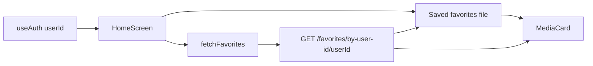

# Remote favorites on the home screen

The home tab used to show a hardcoded list of media from `src/data/media.ts`. It now loads the favorites of the signed-in Clerk user from the API, so each account sees its own list.

```
GET https://flucom-api-bun.developedbyluan.workers.dev/favorites/by-user-id/{userId}
```

The endpoint returns a JSON array of objects with the same fields as `MediaItem`, so `MediaCard` did not change. No auth header is sent.

The last list the app received is saved on the phone. With no internet connection, the app still opens for a user who has signed in before and shows that user's saved favorites.



## Files changed

### `src/data/media.ts`

- Kept the `MediaItem` type.
- Removed the static `mediaItems` array.
- Added `fetchFavorites(userId)`:

```ts
const API_BASE_URL = "https://flucom-api-bun.developedbyluan.workers.dev";

export async function fetchFavorites(userId: string): Promise<MediaItem[]> {
  const response = await fetch(
    `${API_BASE_URL}/favorites/by-user-id/${encodeURIComponent(userId)}`,
  );
  if (!response.ok) {
    throw new Error(`Failed to load favorites (${response.status})`);
  }
  return (await response.json()) as MediaItem[];
}
```

### `src/data/favoritesCache.ts` (new)

Saves and reads each user's favorites as a JSON file in the app's document folder, using `File` and `Paths` from `expo-file-system`.

- The file is named `favorites-<userId>.json` (the user id is URL-encoded), so each account on the phone has its own file.
- `loadCachedFavorites(userId)` returns the saved list, or `null` if there is no file or it can't be read.
- `saveCachedFavorites(userId, items)` writes the list. If writing fails, it logs a warning and the screen carries on.

### `src/app/_layout.tsx`

`ClerkProvider` now has Clerk's offline cache turned on:

```tsx
import { resourceCache } from "@clerk/expo/resource-cache";

<ClerkProvider
  publishableKey={publishableKey}
  tokenCache={tokenCache}
  __experimental_resourceCache={resourceCache}
>
```

Without it, Clerk loads the session from its servers when the app starts, so with no connection a signed-in user could not get past the sign-in screen. With it, Clerk saves its session data on the phone with `expo-secure-store` and can restore it with no connection. The option is experimental in `@clerk/expo` and may change in a later version.

### `src/app/(tabs)/index.tsx`

The screen reads `userId` and `isLoaded` from `useAuth()` in `@clerk/expo`. It passes `{ treatPendingAsSignedOut: false }`, the same option `src/app/index.tsx` uses, so both screens agree on who is signed in.

When `userId` is available, the screen:

1. Reads the saved list and shows it right away if there is one.
2. Calls `fetchFavorites`.
3. On success, saves the new list and shows it.
4. On failure, keeps showing the saved list with an offline notice. With no saved list, it shows the error.

The screen shows one of these states:

| State | What the user sees |
| --- | --- |
| Clerk still loading | Spinner |
| No `userId` | "Sign in to see your favorites." |
| No saved list, request in flight | Spinner |
| Saved list, request in flight | The saved list |
| Request succeeded | One `MediaCard` per item (`id`, `fileName`, `fileAuthor`, `fileThumbnailUrl`) |
| Request failed, saved list exists | The saved list, with "Can't reach the server. Showing your saved favorites." |
| Request failed, no saved list | The error message |
| Empty list | "You have no favorites yet." (plus the offline notice if the request failed) |

The result is stored together with the `userId` it belongs to:

```ts
type FavoritesResult =
  | { userId: string; items: MediaItem[]; error: string | null }
  | { userId: string; items: null; error: string };
```

`error` is set when the latest request failed. If `items` is not `null` at the same time, those items are the saved copy.

If `result.userId` does not match the current `userId`, the screen shows the spinner, so it never shows a previous user's list. This also avoids resetting state synchronously inside the effect, which the `react-hooks/set-state-in-effect` lint rule rejects. The effect sets a `cancelled` flag in its cleanup so a late result from an old request is ignored.

## Verification

- `npx tsc --noEmit` passes.
- `npx expo lint` passes.
- A request to the endpoint with a sample user id returned an array with the expected `MediaItem` fields.
- Expo autolinking includes `expo-file-system` and `expo-secure-store` in Android builds.
- The offline behavior was tested on an Android phone with a preview build.

## Running it on an Android phone

These changes are JavaScript only. They use `expo-file-system` (part of `expo`) and `expo-secure-store` (already a dependency), so the existing development build does not need to be rebuilt.

1. Connect the phone and the Mac to the same Wi-Fi.
2. Run `npx expo start` in the project folder (or `npx expo start --tunnel` if the phone cannot reach the Mac).
3. Open the development app on the phone and scan the QR code.

If the development APK is not installed yet, build it first with `eas build -p android --profile development` (see the README).

After signing in, the home tab should show a spinner and then that account's favorites. An account with no favorites shows the empty-state message.

### Testing offline

1. Open the app with internet, sign in, and let the favorites load. This saves the list and the session.
2. Turn on airplane mode and open the app again.
3. The home tab should show the saved list with the offline notice.

A development build loads its JavaScript from the Mac, so it may not reload with airplane mode on. To test opening the app from scratch with no connection, use a preview build, which includes the JavaScript. See [preview-build.md](preview-build.md) for the steps.

This was tested on an Android phone with a preview build: the app opened with no connection and showed the saved favorites.

## Known limitations

- The endpoint has no authentication. Anyone who knows a user id can read that user's favorites.
- A user must open the app online at least once before anything is saved for offline use.
- Clerk's offline cache (`__experimental_resourceCache`) is experimental and may change when `@clerk/expo` is updated.
- Signing out does not delete the saved favorites file. Other accounts on the phone can't see it, because each account has its own file.
- There is no pull-to-refresh or retry. Reload the app to fetch again.
- Audio and video still stream from their URLs, so they need internet to play. Media can now be downloaded to the phone (see [media-downloads.md](media-downloads.md)), but nothing plays the downloaded files yet.
