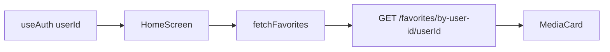

# Remote favorites on the home screen

The home tab used to show a hardcoded list of media from `src/data/media.ts`. It now loads the favorites of the signed-in Clerk user from the API, so each account sees its own list.

```
GET https://flucom-api-bun.developedbyluan.workers.dev/favorites/by-user-id/{userId}
```

The endpoint returns a JSON array of objects with the same fields as `MediaItem`, so `MediaCard` did not change. No auth header is sent.



## Files changed

### `src/data/media.ts`

- Kept the `MediaItem` type.
- Removed the static `mediaItems` array.
- Added `fetchFavorites(userId)`:

```ts
const API_BASE_URL = "https://flucom-api-bun.developedbyluan.workers.dev";

export async function fetchFavorites(userId: string): Promise<MediaItem[]> {
  const response = await fetch(
    `${API_BASE_URL}/favorites/by-user-id/${encodeURIComponent(userId)}`,
  );
  if (!response.ok) {
    throw new Error(`Failed to load favorites (${response.status})`);
  }
  return (await response.json()) as MediaItem[];
}
```

### `src/app/(tabs)/index.tsx`

The screen reads `userId` and `isLoaded` from `useAuth()` in `@clerk/expo`. It passes `{ treatPendingAsSignedOut: false }`, the same option `src/app/index.tsx` uses, so both screens agree on who is signed in. When `userId` is available, it calls `fetchFavorites`.

The screen shows one of these states:

| State | What the user sees |
| --- | --- |
| Clerk still loading | Spinner |
| No `userId` | "Sign in to see your favorites." |
| Request in flight | Spinner |
| Request failed | The error message |
| Empty list | "You have no favorites yet." |
| Success | One `MediaCard` per item (`id`, `fileName`, `fileAuthor`, `fileThumbnailUrl`) |

The result is stored together with the `userId` it was fetched for:

```ts
type FavoritesResult =
  | { userId: string; items: MediaItem[]; error: null }
  | { userId: string; items: null; error: string };
```

If `result.userId` does not match the current `userId`, the screen treats the request as still in flight and shows the spinner, so it never shows a previous user's list. This also avoids resetting state synchronously inside the effect, which the `react-hooks/set-state-in-effect` lint rule rejects. The effect sets a `cancelled` flag in its cleanup so a late response from an old request is ignored.

## Verification

- `npx tsc --noEmit` passes.
- `npx expo lint` passes.
- A request to the endpoint with a sample user id returned an array with the expected `MediaItem` fields.
- The screen has not been tested on a device yet.

## Running it on an Android phone

This change is JavaScript only and adds no native packages, so the existing development build does not need to be rebuilt.

1. Connect the phone and the Mac to the same Wi-Fi.
2. Run `npx expo start` in the project folder (or `npx expo start --tunnel` if the phone cannot reach the Mac).
3. Open the development app on the phone and scan the QR code.

If the development APK is not installed yet, build it first with `eas build -p android --profile development` (see the README).

After signing in, the home tab should show a spinner and then that account's favorites. An account with no favorites shows the empty-state message. The phone needs internet access to reach the API.

## Known limitations

- The endpoint has no authentication. Anyone who knows a user id can read that user's favorites.
- There is no pull-to-refresh or retry. Reload the app to fetch again.
